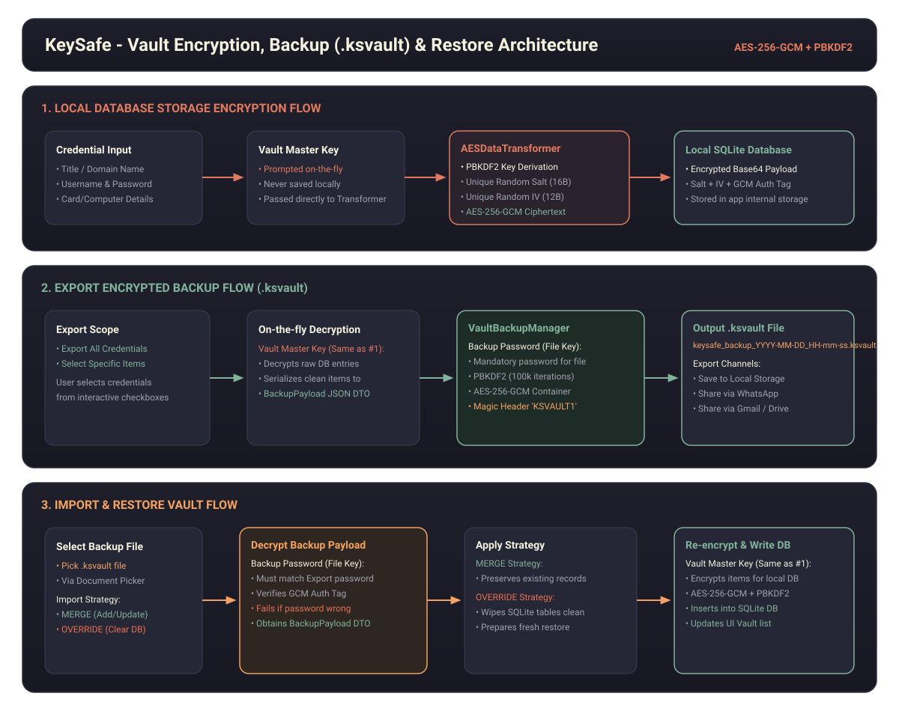
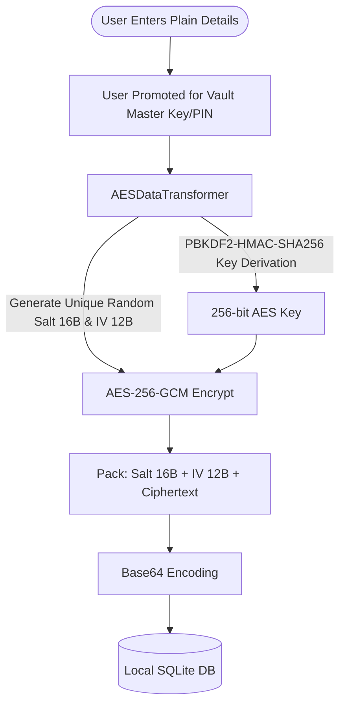
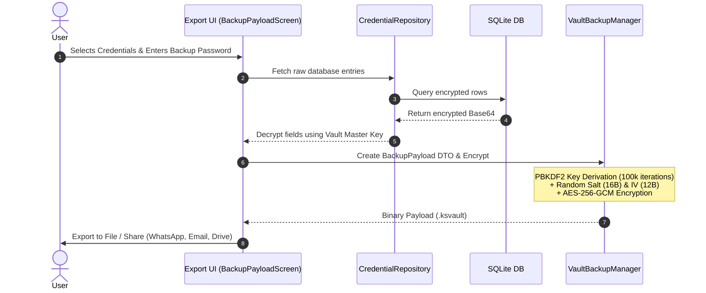
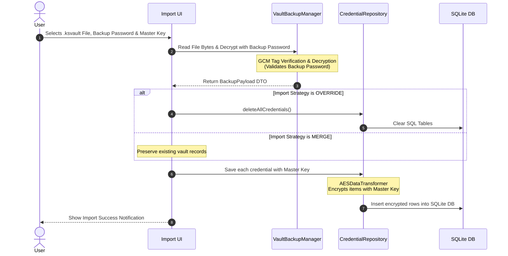

# KeySafe - AI Agent Instructions

Welcome, AI Agent! This file contains guidelines and context to help you contribute effectively to the **KeySafe** project.

## Project Overview
KeySafe is a secure Android credential vault application built with Kotlin and Jetpack Compose. Security, data integrity, clean architecture, and privacy are the highest priorities for this project.

### Core Features
- **App Theme**: Supports Dark, Light, and System default modes with custom font styling and font size scaling.
- **Localization & Multi-Language Support**: All user-facing text (titles, labels, buttons, placeholders, dialogs, error messages, navigation items) is strictly externalized into `res/values/strings.xml`. ViewModels use a `UiText` wrapper (`UiText.StringResource`) to deliver localized error messages without holding Android `Context`.
- **Edge-to-Edge UI**: Full edge-to-edge layout support drawing seamlessly behind system bars with keyboard `imePadding()` management on scrollable forms.
- **Adaptive Layouts**: Support for Foldables, tablets, and orientation changes (Portrait/Landscape).
- **On-the-fly Encryption/Decryption**:
  - Encryption keys are **never** saved locally. 
  - Sensitive vault data stored in local SQLite database is encrypted on-the-fly using military-grade **AES-256-GCM + PBKDF2-HMAC-SHA256** key derivation with unique random Salt & IV per entry via `AESDataTransformer` (with automatic fallback support for legacy AES-CBC entries).
  - Whenever encryption or decryption is needed, the app prompts the user via a UI popup to enter their key/PIN to process it on the fly.
- **Key & PIN Terminology & Length Criteria Standard**:
  - **Vault Master Key** (`Icons.Default.Key`): Min 4 chars, recommended 8-32+ chars, unlimited max limit (PBKDF2 hashes any length into 256-bit AES key). Accepts letters, numbers, spaces, and symbols. NEVER saved locally.
  - **App Unlock PIN** (`Icons.Default.Lock` / `Icons.Default.Fingerprint`): 4 to 8 numeric digits. Optional local PIN used to unlock the app UI on launch or idle timeout.
  - **Backup File Password** (`Icons.Default.Lock`): Min 4 chars, recommended 8-32+ chars, unlimited max limit. Password set during export to encrypt the `.ksvault` binary backup container.
  - **Item Security PIN** (`label_item_pin`): Optional PIN value stored inside a credential record (e.g. 4-digit ATM card PIN or system login PIN).
- **Offline Favicon Caching**: Domain favicons are fetched via Google Favicon API and aggressively cached offline using a custom Coil `ImageLoaderFactory` (`KeySafeApp.kt` & `ImageLoaderUtils.kt`).
---

## Visual Encryption & Backup/Restore Flow

### 1. Data Creation & Local Database Encryption Flow
When a user creates or edits a credential, sensitive fields (username, password, PIN, note, card numbers, security answers) are transformed before being written to SQLite DB.

---

### 2. Export Backup Flow (`.ksvault`)

The export flow decrypts local DB records on-the-fly and packages them into an authenticated, encrypted binary container (`.ksvault`).

#### Export Key Criteria & Mechanics:
- **Vault Master Key**: Used on-the-fly to read & decrypt existing records stored in local SQLite DB.
- **Backup Key / Password**:
  - **Purpose**: Secures the exported `.ksvault` binary file so it can be safely transmitted over untrusted channels (WhatsApp, Email, Drive).
  - **Criteria**: Mandatory non-empty password set by the user specifically for this backup file.
  - **How it works**: `VaultBackupManager` derives a 256-bit key from the Backup Password using PBKDF2-HMAC-SHA256 (100,000 iterations) with a new random 16-byte salt and 12-byte IV, encrypting the serialized `BackupPayload` JSON into a `.ksvault` container.

---

### 3. Import & Restore Flow

The import flow decrypts the `.ksvault` file using the Backup Password and re-encrypts the credentials into the local SQLite DB using the Vault Master Key.

#### Import Key Criteria & Mechanics:
- **Strict Extension Validation**: Only files ending with `.ksvault` are accepted by the file picker launcher. Selecting any non-`.ksvault` file automatically rejects the selection and presents an error message (`error_invalid_file_type`).
- **Progressive UI Reveal**: On the Import Backup tab, initially only the **'Select .ksvault File'** button and instructions are displayed. The Import Strategy options, password input fields, and the 'Import & Restore Vault' action button are revealed once a valid `.ksvault` file is selected.
- **Backup Password**:
  - **Purpose**: Unlocks and decrypts the `.ksvault` binary container.
  - **Criteria**: Must match the exact password used when exporting the backup. If incorrect, GCM authentication tag verification fails and blocks import (`"Invalid Backup Password or corrupted file"`).
- **Vault Master Key**:
  - **Purpose**: Encrypts the restored credentials into local SQLite DB storage.
  - **Criteria**: Mandatory non-empty string. Ensures imported records are securely stored in local DB using the app's standard AES-256-GCM + PBKDF2 transformer.

---

## Architecture & Code Organization

### Technology Stack
- **Language**: Kotlin (Idiomatic, platform-agnostic domain/data structure ready for KMP/CMP)
- **UI Framework**: Jetpack Compose (Material 3 warm peach palette)
- **Material 3 Expressive Features**: KeySafe leverages the `androidx.compose.material3` library (version `1.5.0` or higher) as the primary way to adopt standard Material 3 components and brand new **M3 Expressive features** (such as the `CircularWavyProgressIndicator` loading animations). Components utilizing expressive features require the `@OptIn(androidx.compose.material3.ExperimentalMaterial3ExpressiveApi::class)` annotation.
- **Navigation**: Jetpack Navigation 3 API (`NavDisplay` with `Screen` key definitions)
- **Dependency Injection**: Koin DI split into segregated modules:
  - `dataModule` (Database, Repository, DataStore Settings, AES Transformer)
  - `domainModule` (AppLockManager, UseCases)
  - `viewModelModule` (Viewmodel declarations)

### Modular Screen & ViewModel Hierarchy (`ui/screens/add/` & `ui/viewmodel/add/`)
To prevent monolithic God classes, the credential creation/editing flow is segregated by category using OOP inheritance:
- **ViewModels**:
  - `BaseAddCredentialViewModel`: Base abstract class managing common state (title, PIN, notes, favorite, security questions) and saving lifecycle.
  - `AddSiteViewModel`: Category-specific validation and `SiteCredential` mapping.
  - `AddCardViewModel`: Category-specific validation, MM/YY date range logic, and `CardCredential` mapping.
  - `AddComputerViewModel`: Category-specific validation and `ComputerCredential` mapping.
- **Screen Composables**:
  - `BaseAddCredentialScreen`: Wraps scaffold, top bar, encryption dialog, and favorite toggle.
  - `SharedFormElements`: Renders optional/collapsible PIN, Note, and Security Questions fields.
  - `AddSiteScreen`, `AddCardScreen`, `AddComputerScreen`: Render category-specific form templates.

---

## App Workflow & Lifecycle

### 1. Launch & Play Store Updates
- On cold start and resume, `MainActivity` checks for updates via `AppUpdateManager` and triggers an `IMMEDIATE` update if available.

### 2. Onboarding (First-Time Launch & Take Tour)
- If the `isOnboardingCompleted` flag in `SettingsManager` is `false`, the user is greeted with a 3-step `HorizontalPager` **Onboarding/Walk-through**.
- Steps introduce KeySafe's core value propositions: Ultimate Security, Zero Knowledge, and Secure Backups.
- Tapping "Get Started" or "Skip" sets `isOnboardingCompleted` to `true` and advances the app state.
- **Take Tour**: Users can replay the entire onboarding experience at any time by selecting "Take App Tour" in `SettingsScreen`.

### 3. Optional App Lock (First Launch vs Enabled)
- **App Lock is disabled by default on first launch**. The user lands directly on `HomeScreen` without being forced to set up a PIN/Biometrics.
- If the user enables **"App Lock"** in `SettingsScreen` (and no auth method is set), `MainActivity` presents `SetupAuthScreen` prompting them to choose between "Device Lock" (Biometrics/System PIN) or creating a custom 4-8 digit "App PIN".
- When App Lock is enabled and locked, `MainActivity` intercepts navigation to present `AuthScreen` (Biometric prompt) or `PinAuthScreen` (Custom PIN pad).
- Idle lock timeouts (Immediately, 1m, 5m, 10m, 15m, 30m) are tracked via `AppLockManager` attached to `ProcessLifecycleOwner`.

### 4. Navigation & Bottom Bar Flow
- **Bottom Navigation Bar**: Provides instant access to five top-level destinations: **Accounts**, **Favorites**, **Backup** (`.ksvault` export/import), **Support** (FAQs & Customer Email Assistance), and **Settings**.
- **Debug-Only Mock Data Seeding**: The "Load & Encrypt Mock Data" row on the Home screen is strictly guarded by `BuildConfig.DEBUG` and is hidden in Release (production) builds.
- **Custom Profile Picture & Interactive Crop (`ProfileImageCropDialog`)**:
  - Tapping the Profile avatar in the Home top search section opens the system photo picker (`ActivityResultContracts.PickVisualMedia`).
  - Upon selecting an image file (JPEG, PNG, WEBP), `ProfileImageCropDialog` presents an interactive viewport with a circular frame and zoom slider for positioning.
  - Tapping "Save" crops the circular avatar bitmap to `context.filesDir/profile_avatar.png` and persists the path in DataStore (`SettingsManager`), replacing the default `AccountCircle` icon.
- **Home Screen Category Chips** (`All`, `Site`, `Card`, `Computer`):
  - Selecting a category chip filters the credential list.
  - Tapping **"Add credential"** while a specific category chip (`Site`, `Card`, `Computer`) is active routes **directly** to that category's form (`AddSiteScreen`, `AddCardScreen`, or `AddComputerScreen`).
  - Tapping **"Add credential"** while the `All` chip is active opens `CategorySelectionDialog` popup for the user to select the category.

---

## Form Validation & Template Rules

### 1. Category-Specific Mandatory Fields & Visual Indicators
Mandatory fields are visually indicated with a red asterisk (`*`):
- **Site**: Site / Domain Name (`*`), Username (`*`), Password (`*`).
- **Card**: Card Name / Label (`*`), Card Type (Credit/Debit), Bank / Issuer Name (`*`).
- **Computer**: Computer Name / Label (`*`), Operating System (Windows/Mac/Linux/Android), Username (`*`), Password (`*`).

### 2. Dynamic Input Validation Rules & M3 Support
- **Inline Error Clearing**: Error messages clear instantly as the user types/modifies the text in the field. Clearing a field removes inline errors until validation is re-triggered on Save.
- **Material 3 Expressive Error States**: All error messages on `OutlinedTextField` and `TextField` MUST use the native Material 3 `supportingText` property (e.g. `supportingText = errorMessage?.let { { Text(it) } }`). Do not render floating `<Text>` fields manually below inputs.
- **Domain Validation**: Real-time domain regex validation (`^[a-zA-Z0-9.-]+\.[a-zA-Z]{2,}(/.*)?$`) on domain field loss of focus.
- **Card Validity Dates (MM/YY)**:
  - Input is capped at 4 digits (`MMYY`) and formatted visually as `MM/YY`.
  - Typing a digit `2-9` for the month automatically prefixes a `0` (e.g., typing `5` becomes `05`).
  - Validates month `MM` range (`01` to `12`).
  - Ensures `Start (MM/YY) < Expiry (MM/YY)` (expiry date must be after start date).

### 3. Collapsible Optional Form Sections ("Add more info")
- **Item Security PIN**, **Note**, and **Security Questions** are optional and **hidden by default** when adding a new credential.
- An **"Add more info ˅"** clickable header toggles showing/hiding the optional pill chips (`[🔑 Item Security PIN]`, `[📝 Note]`, `[❓ Security Questions]`). The chips are hidden by default.
- Tapping any pill chip expands that optional field on demand. Expanded fields include a Close (`X`) action to collapse and clear the field.
- When editing an existing credential that contains a PIN, note, or security questions, those sections render expanded automatically.
- **Hidden Select App Feature**: The "Select app" button in `SiteTemplateForm` is hidden/commented out for future releases.

### 4. Delete Confirmation
- Credential deletion cannot occur directly. Tapping **Delete** must present an `AlertDialog` confirmation prompt (`dialog_delete_title`, `dialog_delete_message`). Deletion is only executed if the user explicitly confirms the action in the dialog.

### 5. Key Specifications & Info Dialog (`KeyInfoDialog`)
- Whenever a user is prompted to enter or set a **Vault Master Key** or **Backup File Password** (`EncryptionKeyPromptDialog`, `PinVerificationDialog`, `BackupPayloadScreen`), an interactive Info Icon (`Icons.Default.Info`) is provided in the field/dialog.
- Tapping the Info Icon presents `KeyInfoDialog`, explaining the exact key criteria (Min 4 chars, 8+ recommended, unlimited max limit via PBKDF2 256-bit AES derivation, accepting letters, numbers, spaces, and symbols).

---

## Design & UI Guidelines

### 1. Previews
Every `@Composable` screen and base component (`ui/screens`, `ui/screens/add`, `ui/base/components`, `ui/base/dialogs`, `ui/base/templates`) must include `@Preview(showBackground = true)` with mock harnesses for visual inspection in Android Studio.

### 2. Localization
Never hardcode user-visible strings in Composables or ViewModels. Use `stringResource(R.string.key)` in Composables and `UiText.StringResource(R.string.key)` in ViewModels.

---

## Database Schema & Models

### Master Storage: `TABLE_CREDENTIALS`
- **id**: Primary Key, String (UUID)
- **category**: Category Type (`Site`, `Card`, `Computer`)
- **site_or_app**: Title / Domain (Plaintext)
- **site_logo**: Logo URL (Plaintext)
- **username**: Base64 Encrypted via AES-256-GCM + PBKDF2
- **password**: Base64 Encrypted via AES-256-GCM + PBKDF2
- **pin**: Base64 Encrypted via AES-256-GCM + PBKDF2 (Nullable)
- **note**: Base64 Encrypted via AES-256-GCM + PBKDF2 (Nullable)
- **is_favorite**: Boolean (0 or 1)
- **card_type**: Card Type (`Credit`, `Debit`)
- **card_issuer**: Bank Name (Plaintext, Nullable)
- **card_name_on_card**: Base64 Encrypted via AES-256-GCM + PBKDF2 (Nullable)
- **card_number**: Base64 Encrypted via AES-256-GCM + PBKDF2 (Nullable)
- **card_validity_start**: MM/YY (Plaintext, Nullable)
- **card_validity_end**: MM/YY (Plaintext, Nullable)
- **card_cvv**: Base64 Encrypted via AES-256-GCM + PBKDF2 (Nullable)
- **os_type**: OS Type (`Windows`, `Mac`, `Linux`, `Android`)
- **created_at**: Epoch Timestamp
- **updated_at**: Epoch Timestamp

### Child Storage: `TABLE_SECURITY_QUESTIONS`
- **id**: Primary Key, String (UUID)
- **credential_id**: Foreign Key mapping to `TABLE_CREDENTIALS(id)` on Delete Cascade
- **question**: Base64 Encrypted via AES-256-GCM + PBKDF2
- **answer**: Base64 Encrypted via AES-256-GCM + PBKDF2

---

## Agent Guidelines

### 1. Policies & Compliance
- **Copyright**: Use open-source, royalty-free, or originally created assets.
- **Play Console & AdMob**: Adhere to AdMob placement policies (do not obscure UI controls or force accidental clicks) and Google Play Developer Policies.

### 2. Security Practices
- Never log sensitive credentials, PINs, or raw database keys.
- Ensure encryption keys are processed on-the-fly and never persisted in memory or local storage.

### 3. File Modification & Safety
- Use built-in file editing tools (`replace_file_content`, `multi_replace_file_content`, `write_file`).
- Do NOT use shell scripts (`sed`, `awk`, redirection) to edit files.
